# 动画图鉴

> [返回 README](README.md#效果预览)

全部动画（640×360，插件实际播放用的资源）——GIF 预览存放于仓库 `dsh-pet/assets/preview/`（raw 直链渲染，文件名采用拼音便于跨平台）；完整透明视频见插件包 `dsh-pet/assets/webm/`（VP9-alpha，唯一发布格式）：

**待机 / 转向**

  
  

**移动**

  
  
  

**小动作**

  
  
  
  
  
  
  
  
  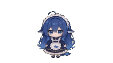
  
  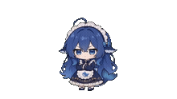
  
  
  
  
  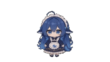
  
  

**玩耍**

  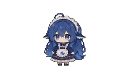
  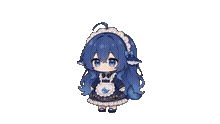
  
  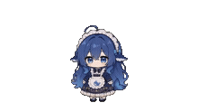
  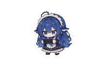
  
  
  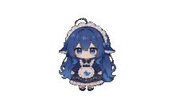
  
  
  
  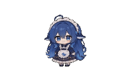
  
  
  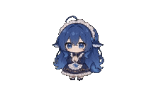
  
  
  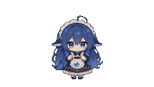
  
  
  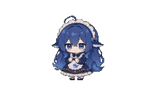
  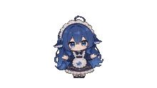
  
  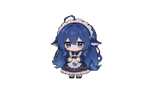
  
  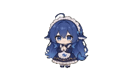
  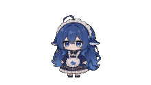

**吃什么**

  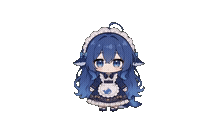
  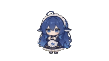
  
  
  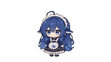
  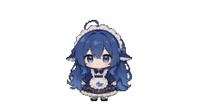
  
  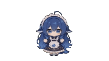
  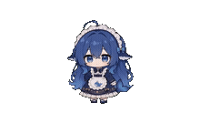
  
  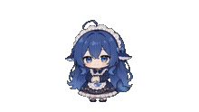
  

**时节**

  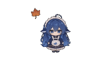
  
  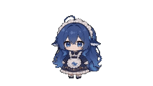
  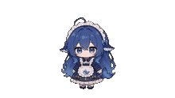
  
  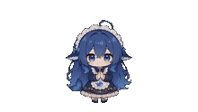
  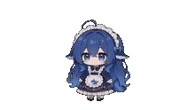
  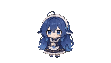
  
  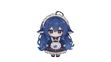
  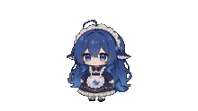
  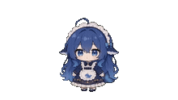
  
  
  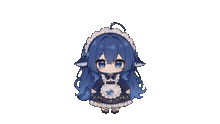
  
  
  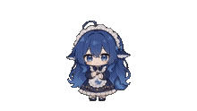
  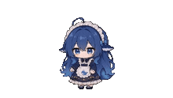
  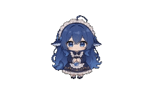
  

**文字**

  
  

**点击回应**

  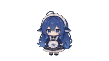
  
  
  
  

**拖拽**

  

**余额事件**（按余额已用百分比分档，满格 → 告急 → 耗尽）

  
  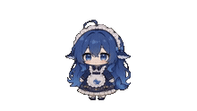
  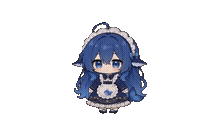
  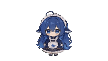
  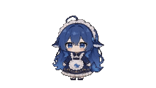
  

**碎碎念说话动画**（碎碎念 / 对话回复触发，随机抽 1 段）

  
  
  

**工作状态动画**（跟随 DSH 会话事件，六档：思考 / 工作 / 整理 / 等待 / 成功 / 出错）

  
  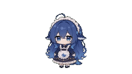
  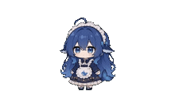
  
  
  

**睡觉**（右键「睡觉」或鼠标停上去按 `S`；睡着时点一下叫醒）

  
  
  

> 注：动画为透明背景；GIF 预览中透明部分显示为页面底色，实际 webm 播放为透明。
