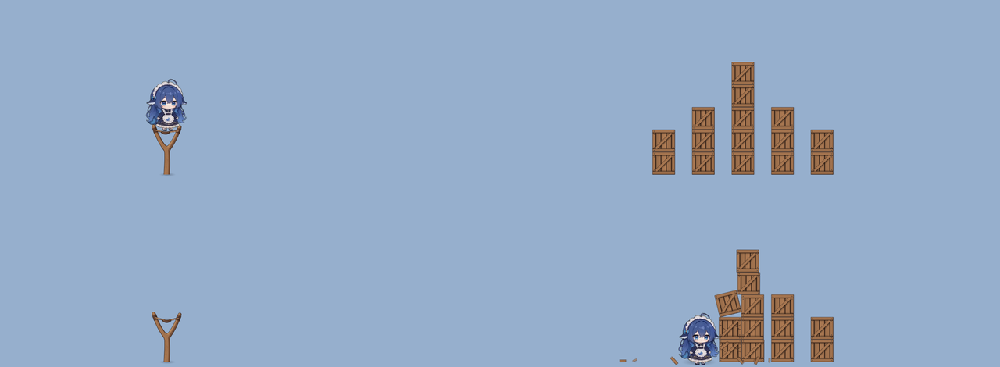

# dsh-pet · 独立增强版 🐾

> 本仓库是 [PC2005-cloud/dsh-pet](https://github.com/PC2005-cloud/dsh-pet) 的 fork（原作者：PC2005-cloud）。
> 宠物本体、动画素材、素材生成链、DSH 插件用法等完整文档请看上游仓库；这里只写**本 fork 额外做了什么、怎么用**。

<p align="center">
  
  <br><sub>右键「弹弓」：透明窗口直接画在桌面上（图里的蓝底只是为了看清透明区域）。上：开局；下：撞上木箱之后。</sub>
</p>

上游的 dsh-pet 是一只住在 [DeepSeek Harness](https://github.com/deepseek-ai/deepseek-harness)（DSH）里的桌面宠物，也能用 `dsh-pet-standalone` 脱离 DSH 单独运行——但独立模式下**对话、碎碎念不可用**（它们依赖 DSH 的模型与凭证）。

这个 fork 面向**只用桌面宠物、不装 DSH** 的场景，补上了三块：

| | 功能 | 一句话 |
|---|---|---|
| 💬 | **独立模式 AI** | 自己填一个 OpenAI 兼容 / Anthropic 接口，独立模式下也能「对话」和「定时碎碎念」 |
| 🪟 | **Windows 启动器** | 后台静默启动 / 安全退出、防多开、开机自启、每周自动拉取上游（只拉不改） |
| 🎯 | **弹弓小互动** | 右键「弹弓」：把宠物拽住往后拉、松手弹出去撞木箱——纯桌面互动，没有分数关卡 |

---

## 快速开始（从源码，独立模式）

需要 Node.js ≥ 22.12。仓库用 pnpm 管理依赖（没装可以用 `npx pnpm@11`）。

```sh
git clone https://github.com/kanoha222/dsh-pet.git
cd dsh-pet/dsh-pet          # 插件目录
pnpm install                # 或 npx pnpm@11 install
npm run build               # 构建 lib + 桌面共享核心 + 弹弓用的 matter-js
npm run standalone          # 启动：http://127.0.0.1:3080/dsh-pet-7340/（端口被占会顺延）
```

- 首次启动会自动下载 Electron（放在 `DSH_HOME` 下），之后桌面上出现透明置顶的宠物小窗。
- `node lib/standalone.js --port 3100` 换端口；`--check` 只体检不开窗口；`Ctrl+C` 或 `POST /shutdown` 退出。
- 宠物配置与上游同一份：`$DSH_HOME/dsh-pet/main-config.jsonc`（大小、位置、动画权重……），字段说明见上游 README。

---

## 💬 独立模式 AI（对话 + 碎碎念）

独立模式自带一个**只监听本机**的设置页，填好接口就能用：

1. 打开设置页：右键宠物 →「打开网站」，或 Windows 启动器的 `open-settings.ps1`（会带上本次运行的访问令牌）。
2. 填写：
   - **接口协议**：`OpenAI 兼容`（DeepSeek 官方、OpenAI、各类中转、Ollama 等）或 `Anthropic`；
   - **Base URL**：例如 `https://api.deepseek.com/v1`；
   - **模型**：例如 `deepseek-chat`；
   - **API Key**；
   - 勾选「启用 AI 对话与碎碎念」，按需开启「定时自动碎碎念」并设间隔（默认 300 秒）。
3. 可以先点「测试连接」，再「保存设置」。

之后右键宠物「对话」就能聊天（说话动画 + 头顶气泡，聊天记忆存在 `$DSH_HOME/dsh-pet/memory.json`），「碎碎念」随时来一句。

**安全上的约定：**

- 没填接口之前 AI 功能是关闭的，**不会发起任何网络请求、不会产生费用**；
- API Key 只保存在本机 `$DSH_HOME/dsh-pet/standalone-ai.json`（收紧文件权限），设置页保存后不回显，也不会出现在日志或接口返回里；
- 设置页与写操作只接受本机来源，带访问令牌与 CSRF 校验。

---

## 🪟 Windows 启动器

`dsh-pet/scripts/windows/` 是一组 PowerShell 脚本，把独立模式当成一个「装好就不用管」的桌面程序来跑。它们都读同一个部署清单 `deployment.json`：

```jsonc
{
  "nodePath": "C:\\Program Files\\nodejs\\node.exe",
  "entryPath": "D:\\dsh-pet-standalone\\releases\\current\\lib\\standalone.js",
  "workingDirectory": "D:\\dsh-pet-standalone\\releases\\current",
  "pluginRoot": "D:\\dsh-pet-standalone\\releases\\current",
  "dataHome": "D:\\dsh-pet-standalone\\data",          // 作为 DSH_HOME：配置、记忆、AI 设置、Electron、日志都在这里
  "sourceRoot": "D:\\code\\dsh-pet",                   // 本仓库的 clone（每周同步用）
  "port": 31380,
  "gitPath": "C:\\Program Files\\Git\\cmd\\git.exe",
  "expectedOrigin": "https://github.com/kanoha222/dsh-pet.git",
  "expectedUpstream": "https://github.com/PC2005-cloud/dsh-pet.git"
}
```

`releases\current` 里放的是构建好的插件（`lib/`、`runtime/`、`assets/`、`package.json` 与安装好的依赖）。

| 脚本 | 作用 |
|---|---|
| `launch.ps1` | 后台静默启动（无黑框）；全局互斥锁防多开，重复运行不会再开一只 |
| `stop.ps1` | 安全退出：先核对运行中的进程确实是这份部署，再走 `/shutdown` 优雅停机；不会强杀任何进程 |
| `install.ps1` / `disable-autostart.ps1` | 安装 / 移除当前用户的开机自启快捷方式 |
| `register.ps1` / `remove-weekly-sync.ps1` | 注册 / 移除「每周一 09:17 拉取上游」的计划任务 |
| `sync-upstream.ps1` | 立即同步一次：只 `git fetch` 上游到 `refs/remotes/upstream/main` 并记录状态——**不合并、不构建、不重启** |
| `open-settings.ps1` | 用默认浏览器打开本机 AI 设置页 |

用法：

```powershell
powershell -NoProfile -ExecutionPolicy Bypass -File dsh-pet\scripts\windows\launch.ps1 -ConfigPath D:\dsh-pet-standalone\launcher\deployment.json
```

会改动系统的脚本（启动、自启、计划任务、同步）都支持 `-WhatIf`：只打印将要做的事，不真的执行。日志在 `dataHome\launcher-logs\`（自动轮转）。

**更新到新代码**：在仓库里 `npm run build`，把 `lib/`、`runtime/electron-helper/` 拷进一个新的 release 目录，先 `stop.ps1`，再把 `deployment.json` 的三个路径指过去，`launch.ps1` 启动。旧 release 留着，改回路径就能回退。

---

## 🎯 弹弓小互动

右键桌面上的宠物 →「弹弓」。宠物从桌面跳进一个弹弓的皮兜里，右边远远地站着几摞木箱：

- **拉**：按住宠物往后拽，皮筋跟着拉长，脚下有一串小泡泡提示飞行轨迹；拉得太短松手会弹回去；
- **飞**：松手她就被弹出去，在空中轻轻仰俯，落地 / 撞上东西会 Q 弹一下；
- **撞**：木箱是真的刚体——被撞的那摞会翻倒、互相砸；撞得重的木箱先裂开，再撞就碎成木片和木屑；
- **回来**：她停下后原地淡出，在皮兜里淡入，又可以再拉；
- **全倒**：每一摞都被推倒了，她会开心地跳一下，木箱再重新码好；
- **退出**：按 `Esc`，或右键宠物 →「回到桌面」；右键 →「重新开始」把木箱复原。

它被刻意做成「桌宠的一个小动作」而不是一个网页游戏：

- **没有分数、星级、关卡、次数、结算面板**，也没有按钮和 HUD；
- **窗口是透明的**，弹弓、木箱、宠物直接画在桌面上；除了宠物身上，整个窗口都点击穿透，透明的地方照常能点桌面；窗口不置顶（避开 Windows 透明置顶窗口盖住视频时的黑屏问题）；
- **宠物大小不变**：场景按桌宠的实际大小缩放，进了弹弓和在桌面上一样大；
- **按屏幕摆位**：宠物（弹弓）离屏幕左边 1/6，木箱离右边 1/6，左右的墙就是屏幕边；屏幕很宽、木箱离得很远时弹力会适当加大，保证总打得到；
- **每次进入都是新的一局**：进入 / 重新开始都整体重建，不会留着上一局的木箱、碎片或速度；
- **美术跟着宠物走**：宠物用的是它自己的动画（被拽着、开心跃动……）；小泡泡直接取自宠物原画的帧；弹弓、皮筋、皮兜、木箱、碎木片、木屑按宠物原画的线条颜色与光照规格离线绘制（`dsh-pet/scripts/game-art/`，可重新生成，规格见那里的 README），没有用 emoji、CSS 或 SVG 拼凑。

实现上：刚体物理用 [matter-js](https://github.com/liabru/matter-js)（MIT，构建时拷进 `runtime/electron-helper/vendor/`），固定步长、带子步，瞄准轨迹用同一套参数的「探针世界」算，在撞到东西之前与真实飞行逐点重合。

| 文件 | 内容 |
|---|---|
| `dsh-pet/src/shared/slingshot-game.ts` | 纯逻辑：场景缩放与摆位、弹弓初速、木箱布局、损伤与「全倒」判定、会话状态 |
| `dsh-pet/runtime/electron-helper/game-physics.js` | matter-js 之上的薄封装（木箱、宠物刚体、碰撞、探针） |
| `dsh-pet/runtime/electron-helper/game.js` | 弹弓页面：输入、状态机、绘制 |
| `dsh-pet/runtime/electron-helper/game-launch.js` | 主进程侧：载荷校验、窗口尺寸、点击穿透判定 |
| `dsh-pet/runtime/electron-helper/pet-frame-filter.js` | 把宠物视频帧画进 canvas 前去掉整帧的 alpha 噪声（否则透明桌面上会显出一个淡淡的方框） |

---

## 开发与测试

在 `dsh-pet/` 目录下：

```sh
npm test               # 单元 / 集成测试（node --test）
npm run typecheck
npm run lint
npm run format:check
node scripts/prepack-check.js

# 真 Electron 的端到端测试（弹弓：透明 / 穿透 / 真鼠标拉弓 / 撞木箱 / 回弹弓 / Esc 退出 / 重复进入）
DSH_PET_ELECTRON=/path/to/electron.exe node --test scripts/tests/desktop-slingshot.test.mjs
# 可选 DSH_PET_UI_ARTIFACTS=<目录>：保存弹弓窗口的透明截图
```

端到端测试用的是隔离的 mock 宿主，不读写你自己的配置与凭证；它会真的在桌面上开窗口，跑的时候别动鼠标。

---

## 与上游同步

```sh
git remote add upstream https://github.com/PC2005-cloud/dsh-pet.git   # 只需一次
git fetch upstream
git merge upstream/main
```

Windows 启动器的每周同步只做上面的 `fetch`，合并与重新部署都需要你自己来。

## 许可

- 沿用上游许可：代码 MIT（见 [LICENSE](LICENSE)）；素材（动画 / 提示词 / 源视频）允许开源使用，**禁止商用**。
- 按上游的二创约定：本仓库是基于原作的衍生版本，原作者 GitHub 地址：<https://github.com/PC2005-cloud/dsh-pet>。
- 弹弓用到的 matter-js 为 MIT 许可，许可证全文随构建拷贝到 `runtime/electron-helper/vendor/matter-js.LICENSE`。
