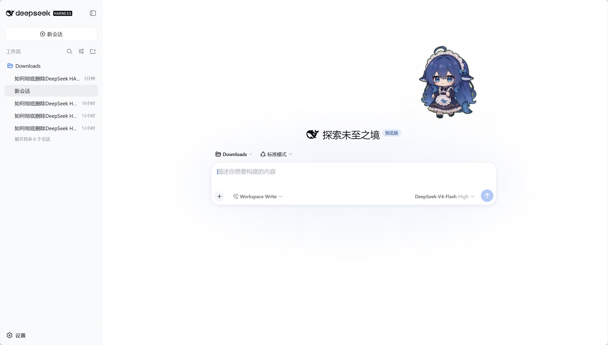
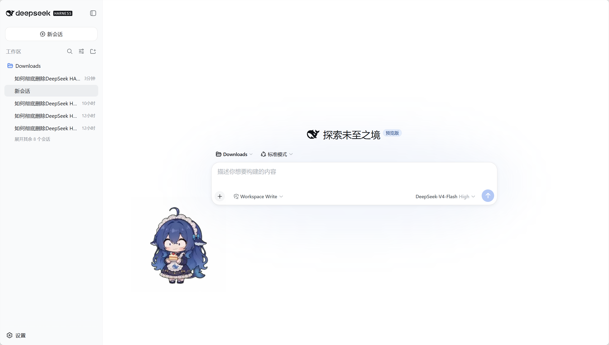
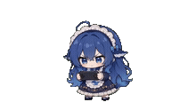

# dsh-pet 🐾

<p align="center">
  <a href="https://www.npmjs.com/package/dsh-pet"></a>
  <a href="https://www.npmjs.com/package/dsh-pet"></a>
  <a href="https://www.npmjs.com/package/dsh-pet"></a>
  <a href="https://github.com/PC2005-cloud/dsh-pet"></a>
  <a href="https://github.com/PC2005-cloud/dsh-pet/blob/main/LICENSE"></a>
  <a href="https://awesome-dsh-plugin.com"></a>
  <a href="https://github.com/PC2005-cloud/dsh-pet"></a>
  <a href="https://github.com/PC2005-cloud/dsh-pet/issues"></a>
  
  
</p>

一只住在 [DeepSeek Harness](https://github.com/deepseek-ai/deepseek-harness) 里的桌面宠物：待机呼吸、随机动作（打瞌睡、玩魔方、吃火锅……）、左右转向、屏幕漫游、点击 Q 弹、拖拽甩抛反弹、右键菜单点播——一百余个透明动画随时无缝衔接；还能跟随 DSH 会话事件切换工作状态动画、按档位播放余额动画 + 头顶气泡、碎碎念与对话聊天、窗口失焦时弹系统通知。可多开同屏，能脱离浏览器住上**桌面**（透明置顶小窗），也能自己添加**全新宠物种类**（pet pack）。

这不是一个普通插件，而是**完整的三件套项目**：

```
① 提示词（配方）    →  ② 素材生成链（引擎）  →  ③ 插件（成品）
AI 生成动画的配方     源视频 → 透明动画的管线    运行在 DSH 里的宠物
```

任何人 clone 本仓库，都可以**从零生成自己的桌面宠物**——换角色、换动作、换风格，全流程可复现。

---

## 快速开始（安装插件）

装法取决于你在用哪个 DSH：

### 🪟 桌面应用（Electron 版）

直接在应用内「插件管理」页的安装框里填 `dsh-pet`，不用开终端；需要在终端里操作插件时，用桌面应用自带的那份 CLI。

### 🌐 `dsh web`

> 以下命令都在你的**命令行终端**（PowerShell / CMD 等）中运行。前提是 DSH 环境已就绪：

```sh
# ① 前置要求：确认 Node.js 已安装
node -v

# ② 安装 DSH 启动器与 pnpm（已装可跳过；装完请重新打开终端）
npm install -g @deepseek-ai/dsh pnpm
dsh --version   # 验证 dsh 命令可用

# ③ 安装本插件（web 模式用 --profile web）
dsh plugin --profile web add dsh-pet
```

装完**重开桌面应用**（`dsh web` 用户则重启 `dsh web`）才生效——运行中的进程持有内存里的旧插件。宠物出现在界面右上角（默认配置角落，可在设置页修改）。

> **兼容性**：本插件当前在 dsh **`0.2.1-rc.2`** 下开发并测试（`dsh --version` 可查看你的版本）。建议使用相同版本；其他版本如遇问题欢迎反馈。

### 从源码安装（clone 本仓库后）

`lib/` 构建产物不入库，clone 后需要先构建再安装：

```sh
# ① clone 本仓库，进入插件目录
git clone https://github.com/PC2005-cloud/dsh-pet.git
cd dsh-pet/dsh-pet

# ② 安装依赖
npm install

# ③ 构建（完整 lib：tsdown → lib + 桌面共享核心 + 类型声明）
npm run build       # 必须手动跑一次（克隆后 npm install 不再自动构建）

# ④ 安装到 DSH（file: 指向**插件目录**——上面 cd 进去的那一层，用构建好的 lib）
#    --profile 填实际在用的那个：dsh web → web；
#    桌面应用（Electron 版）改用应用内「插件管理」安装，见上方快速开始
dsh plugin --profile web add file:D:/path/to/dsh-pet/dsh-pet
```

> 注：`npm run build`（即 `scripts/prepare.js`）才产出**完整可安装**的 lib——除 tsdown 构建外还构建桌面共享核心（`shared-core.js`）、生成类型声明并收敛发布 `files` 清单；裸 `tsdown` 构建会缺桌面运行时与类型。发布与打包（`npm publish` / `npm pack`）时由 `prepack` 自动调用它，克隆仓库后需手动跑一次。

### 安装后你会看到什么

默认配置是 `display: "both"`（浏览器与桌面都显示），所以重开 DSH 之后会依次出现两处，不必手动开：

1. **浏览器端先出现。** 宠物落在界面右上角（默认角落，设置页可改），此时桌面上还是空的。
2. **宿主自动补桌面运行时。** 本机没有 Electron 时，插件会自己下载一份（落在 `~/.dsh/electron`，同一版本只下一次；默认走 npmmirror 镜像）。进度直接打在 DSH 的控制台里，形如：

   ```
   [dsh-pet] Electron not found, downloading to <用户目录>/.dsh/electron/electron.exe ...
   [dsh-pet] Electron not found, downloading v43.3.0 (win32-x64) ...
   [dsh-pet] downloading 42.3MB / 104.1MB
   [dsh-pet] download complete (37.5s), extracting to <用户目录>/.dsh/electron ...
   ```

   这一步在**后台**进行，浏览器里的宠物照常可用；要等多久取决于网速（几十秒到几分钟），期间不用管它。
3. **桌面端随后出现。** 解压完自动拉起桌面 Helper，同一只宠物以透明窗形式落到桌面上——**此时屏幕上一共两只**：浏览器里一只、桌面上那只，共用同一份配置与同一套动画。
4. **想只留一只。** 两条路都行，改完即时生效：
   - **设置页**：选中该宠物 →「显示位置」下拉框 → 仅浏览器 / 仅桌面 / 两者都显示 / 都不显示；
   - **宠物右键**：菜单里的「显示位置」子菜单 → 仅网页 / 仅桌面 / 两者 / 都不（不用回设置页）。

> 已经装过 Electron（或设了 `DSH_PET_ELECTRON_PATH` 指向现成可执行文件）时，第 2 步会跳过，桌面端几乎立刻出现。下载失败**只影响桌面模式**：控制台会给出提示，浏览器里的宠物不受影响；网络受限时可以设 `DSH_PET_ELECTRON_MIRROR` 换镜像、`DSH_PET_ELECTRON_VERSION` 指定版本，重启后再试。

## 插件功能

- **纯粹的桌宠**：不做天气、监控等无关功能，不碰 DSH 内核；可选能力只有下面这些（余额 / 碎碎念 / 对话 / 工作状态 / 系统通知）
- **动画链**：每个动画（含待机）播完即按权重选下一个（默认 idle 10 / turn 5 / move 5 + 分类权重，`config.jsonc` 可调），首尾相接
- **事件动画**：余额 / 碎碎念 / 工作状态按档位触发专属动画；档位支持候选数组——触发时档内随机、循环播放自动轮换，避免连播同一段
- **多开**：同时显示多个宠物，各自独立大小与位置（设置页「桌宠配置」添加/删除）
- **屏幕漫游**：朝朝向方向行走，先探测空间、不走出屏幕（多屏按各屏边界判定；设置页「锁定在当前屏幕」开启后只在当前所在那块屏内走）
- **点击 / 拖拽 / 甩抛**：点击有回应动画并 Q 弹挤压；拖拽过阻尼弹簧跟手，甩出即抛物线飞行、屏幕边缘反弹、落地摩擦停稳并 Q 弹一下；温柔放下原地停住；两端同一套纯函数物理与挤压曲线（`dsh-pet/src/shared/physics.ts`）
- **右键菜单**：「动作 → 分类 → 具体动画」任意点播（移动类动画点播会真实行走一段）；工具项——浏览器端：碎碎念 / 对话 / 回到初始位置；桌面端：+ 打开网站、查看余额（余额启用时显示）、重载配置（改完配置文件直接右键重载全部桌面宠物，不必回设置页点保存）
- **「打开网站」按宿主自动分派**：宠物宿主是 **DSH 桌面应用**时，该项自动变成「打开 DeepSeek Harness」——用应用自注册的 `dsh://open` 协议把桌面应用主窗口唤到前台（已运行则前置、未运行则拉起）；宿主是 `dsh web` / 独立模式时，仍是系统默认浏览器打开站点
- **朝向与落地**：全部动画可镜像（可朝左 / 朝右）；脚底线统一，宠物始终站在地面上
- **流畅切换**：双缓冲交叉淡入，切换无空白帧
- **余额展示**：按已用百分比分档播余额动画 + 头顶联想气泡（10 秒自动消失）；DeepSeek 显示账户余额，OpenCode Zen Go 与 Command Code 显示最紧迫的一个额度窗口；**未登记余额接口的服务商改为弹文字说明**（不静默）；按宠物独立开关
- **碎碎念与对话**：碎碎念按周期自动生成一句（说话动画 + 气泡，也可手动触发）；对话在右键弹输入框与宠物聊天，记忆持久化（浏览器 / 桌面共享同一份）
- **工作状态联动**：监听 DSH 会话事件，切「思考 / 工作 / 整理 / 等待 / 成功 / 出错」档位动画 + 常驻气泡；目标多轮任务只在真正收尾轮庆祝
- **系统通知**：窗口失焦时弹系统 toast（对话完成 / 生成失败 / 输出截断 / 权限申请 / 用户选择）
- **桌面模式（可选）**：每只宠物开一个独立透明置顶局部小窗，与浏览器严格同行为、共用同一份素材与纯逻辑（见下节）
- **pet pack（额外宠物种类）**：`pet/` 下建 `种类名-config.json` + `种类名-animation/` 即新增独立动画池与素材的全新种类，多实例共享素材（见 [CONFIG.md](CONFIG.md) 的「方式四」）
- **自定义动画**：往 `main-animation/webm/` 放 VP9-Alpha 的 `.webm` 即为新动画，优先于包内素材
- **无障碍**：支持 `prefers-reduced-motion`（减少动效时跳过 Q 弹挤压与淡入切换）

## 🔌 对外接口（供其他插件调用）

桌宠不只自己玩，也**对外开放两条调用通道**，让别的插件或脚本能驱动它、读它的状态。

- **能做什么**：让它说一句指定的话、播一段指定动画、与它对话；读它当前说的话、工作状态、系统通知与余额
- **为什么开放**：桌宠不该只是个摆设——比如一个「女仆」插件巡检验完想说句话，就能让桌宠当它的「实体」开口；也方便任何人基于它做二次开发
- **通道一 · HTTP**：挂在 DSH 自己的 Web 服务上（前缀 `/dsh-pet-7340`，只监听本机、无鉴权），跨进程、脚本可直接调。动作类接口只回 `{ok}`，数据统一从 `GET /state` 读
- **通道二 · Cordis 服务**：客户端半侧在 DSH web 页面内注册，同页客户端插件用 `ctx.get('petApi7340')` 直接取，零网络、零端口；只在该页面实例内有效，方法与返回见 [`CORDIS.md`](CORDIS.md)

相关文件（HTTP 与 Cordis 各一套）：

- [`API.md`](API.md) —— HTTP 接口一览（每个接口一句话，功能预览）
- [`openapi.yaml`](openapi.yaml) —— 完整契约（OpenAPI 3.1，可直接导入 Swagger UI / Postman）
- [`CORDIS-API.md`](CORDIS-API.md) —— Cordis 服务一览（每个成员一句话，功能预览）
- [`CORDIS.md`](CORDIS.md) —— 对外 Cordis 服务（客户端半侧，页面内 `ctx.get('petApi7340')`，不走网络）
- [`tools/api-tester.html`](tools/api-tester.html) —— HTTP 侧示例：桌宠控制台，扮演第三方消费方，可直观试用（`node tools/api-tester.cjs` 启动）
- [`tools/cordis-probe`](tools/cordis-probe/README.md) —— Cordis 侧示例：扮演同页客户端插件，用 `ctx.get()` 消费服务

扩展做出来后欢迎分享：统一收录在 [PC2005-cloud/petE](https://github.com/PC2005-cloud/petE)——本项目的扩展收录仓库，每个扩展占一个目录、元信息写在 `plugin.json`，列表由流水线生成。想把自己的加进去，按仓库里的 `CONTRIBUTING.md` 提 PR 即可。安装：`dsh plugin --profile web add "github:PC2005-cloud/petE#path:/<扩展目录>"`。收录不代表对功能或安全性的审核，安装前请自行阅读代码。

## 兼容性

- **操作系统**：Windows / Linux / macOS 三端均可运行——浏览器 overlay 与桌面模式（Electron 透明置顶窗）行为完全一致；Electron 按平台自动探测/下载（`electron.exe` / `Electron.app` / linux 单文件），无需手动安装
- **无头 / 无桌面环境**：支持 Linux headless 等无图形会话——桌面模式自动检测显示环境（Linux 无 `DISPLAY` / `WAYLAND_DISPLAY` 时判定无显示、跳过桌面窗口，仅日志告警），浏览器 overlay 不受影响
- **浏览器**：浏览器 overlay 兼容 **Chromium 内核（Chrome / Edge 等）与 Firefox**——透明动画依赖 VP9-Alpha webm，三者均已实测透明确认；**不支持 Safari**（macOS 不认 webm alpha，透明渲染为黑底）——macOS 用 `.mov` 素材（GitHub Release `assets-mov`），下载放入即可（见「②.5 Safari/HEVC 兼容素材」）
- **多显示器**：支持多屏环境——跨屏漫游/抛掷以各屏工作区为界，异构缩放（各屏 DPI 不同）、任务栏条带、屏幕之间空洞均正确判定（横屏 / 竖屏 / 上下叠放皆可）；设置页「锁定在当前屏幕」可让宠物（抛掷与漫游）只在当前所在那块屏内活动

## 🪟 桌面模式（可选，脱离浏览器）

插件内建**双模式**：安装后默认会拉起**独立透明置顶小窗**——为每只桌面宠物各开一个局部窗口（跟随宠物移动，**不铺满屏幕**），与浏览器 overlay 严格同行为、功能完全对齐：

- **依赖**：首次启动自动探测/下载 Electron（`~/.dsh/electron/`，也可 `cd dsh-pet && npm run ensure:electron` 手动触发）；缺失时仅日志告警，不影响浏览器形态
- **开关 = 每只宠物的必填字段 `display`**：`web` = 仅浏览器 / `desktop` = 仅桌面 / `both` = 两者 / `none` = 都不显示；桌面模式渲染 display 含 desktop 的**全部**宠物（多开同屏，与浏览器一致），设置页「桌宠配置」编辑即时生效
- 桌面端数据走独立进程管道，不依赖 DSH 的 HTTP 路由，不受 web 访问闸门影响
- 本地调试：`cd dsh-pet && npm run start:desktop -- http://127.0.0.1:3080/dsh-pet-7340/config`（无宿主时自动回落 HTTP 路径）

## 🧍 独立运行（完全不打开 DSH）

连 DSH 都不用开：插件的宿主半边跑在伪 ctx 上，由一个本机 HTTP 服务接管路由（**路由表仍是插件那一份**）。

```sh
npm install -g dsh-pet        # 必须 npm 装；dsh plugin add 装进 profile，bin 不在 PATH 上
dsh-pet-standalone            # http://127.0.0.1:3080/dsh-pet-7340/（占用则顺延）
dsh-pet-standalone --check    # 只体检
dsh-pet-standalone --port 3100

npm run build && npm run standalone   # 仓库里（先构建）
```

- **能用**：动画链、点击/拖拽/甩抛、右键菜单、多开、自定义动画与表情包、pet pack。
- **不可用**：余额、碎碎念、对话、系统通知——返回带 `reason` 的结构化失败（见 [`API.md`](API.md)）。
- **配置**：与 DSH 同一份（`$DSH_HOME/dsh-pet/main-config.jsonc` → 包内默认）。
- **只显示 `display` 含 `desktop`/`both` 的实例**；端口默认 3080；`Ctrl+C` 或 `POST /shutdown` 退出。
- **与 DSH 内运行可同时开**，但共用 `%APPDATA%\dsh-pet-electron-helper`，可能互相踩缓存（仅告警）。

## ⚙️ 余额展示（Balance）

按 `eventsRefreshSec.balance`（秒）周期拉取当前服务商的余额/用量数据，每次刷新按档位触发一次余额动画，并在宠物头顶弹出**联想气泡**（随宠物大小等比缩放，10 秒自动消失）：

- **DeepSeek 官方（`deepseek-official`）**：气泡显示账户余额（如 `余额 ¥8.79`）；余额按 ¥20 满额折算成已用百分比，分 6 档播放动画（钱袋满溢 → 金袋叮当 → 钱袋如常 → 数金皱眉 → 袋空如洗 → 分文不剩）
- **OpenCode Zen Go（`opencode-go`）**：气泡显示 5h/周/月 三个额度窗口中最先告急的一个（如 `周额度已用 88%` / `2.5 天重置`），同样按已用百分比分档
- **Command Code（`commandcode`，含 GOAT 等套餐）**：气泡显示 5h/周/月 三个额度窗口中最先告急的一个（与 opencode 同一口径：剩余额度最少者，通常先报 5h）；套餐无窗口限制时只报月度窗
- **暂不支持的服务商**：未登记余额接口的服务商**不播档位动画，改为弹一句文字说明**——第一行「当前服务商暂不支持余额查询」，第二行报出当前 provider id（便于自查）；缺凭证 / 抓取失败同理（原因写在第二行）。自动轮询只在**原因变化**时弹一次（不反复打扰），手动 `/balance` 或桌面右键「查看余额」则每次都会弹
- **按宠物开关**：`pets[i].balanceEnabled`（必填布尔）控制该宠物是否触发余额动画/显示气泡
- **所需凭据**：对应 provider 的 API key（`deepseek-official` → `DEEPSEEK_API_KEY`；`opencode-go` → `OPENCODE_GO_API_KEY`；`commandcode` → `COMMANDCODE_API_KEY`），在 DSH 凭据中配置后启用；未匹配的服务商不触发动画，改为弹上面的文字说明气泡

## ⚙️ 碎碎念与对话

- **碎碎念**：`pets[i].whisperEnabled` 开启后，按 `eventsRefreshSec.whisper`（秒，默认 300）周期自动生成一句——每只宠物独立周期、独立文案；触发时随机抽 `events.whisper` 动画 + 头顶说话气泡（10 秒消失）。默认开启
- **手动触发**：右键菜单「碎碎念」随时来一句——不受 `whisperEnabled` 门控（该字段只关自动周期轮询）
- **对话**：右键菜单「对话」或 `/chat` 命令打开输入框，与宠物聊天——回复走碎碎念同款展示（说话动画 + 气泡）；记忆持久化在 `$DSH_HOME/dsh-pet/memory.json`，浏览器与桌面共享同一份；多宠物时先用 `/pet` 选择对话目标
- **语音播报（可选，仅 macOS）**：`voiceEnabled: true` 后，碎碎念与对话回复会用系统 `say` 念出来。默认关闭；播报前会去掉代码块 / 链接 / 配图标记，超过 200 字截断；串行播放、单句 15 秒超时，失败静默——只影响「说不说」，不影响气泡与记忆

## ⚙️ 工作状态联动（Work Status）

`pets[i].workStatusEnabled` 开启后，宠物跟随 DSH 会话活动切「思考 / 工作 / 整理 / 等待 / 成功 / 出错」六档动画 + 头顶气泡：非终态动画循环播、气泡常驻；成功 / 出错播一遍、气泡 10 秒自动收起。

- **档位动画**：`animations.events.workStatus` 数组，索引即档位（勿在中间插入新档，只可追加末尾）
- **气泡文案**：`workStatusTexts` 每档可配多句随机，任务详情（todo）优先
- **档位候选数组**：任意档位槽位可写 `string | string[]`——数组 = 档内随机抽 1，循环播放自动轮换、避免连播同一段（余额 / 碎碎念档位同样适用）

## ⚙️ 配置（大小 / 位置 / 多开）

设置页可改大小、位置、边距、显示位置、余额开关、多开与物理参数；配置文件则可以任意自由配置（动画池、播放权重、事件动画、刷新周期……）。

三种配置途径与「pet pack 额外宠物种类」的完整说明见 **[CONFIG.md](CONFIG.md)**。

## 运行效果

宠物实际运行在 DSH Web 界面中的样子：

<p>
  
  
  
  
  
  
  
  
</p>

## 效果预览

全部动画（640×360，插件实际播放用的资源）——GIF 预览存放于仓库 `dsh-pet/assets/preview/`（raw 直链渲染，文件名采用拼音便于跨平台）；完整透明视频见插件包 `dsh-pet/assets/webm/`（VP9-alpha，唯一发布格式）：

**待机 / 转向**

<p>
  
  
</p>

**移动**

<p>
  
  
  
</p>

**小动作**

<p>
  
  
  
  
  
  
  
  
  
  
  
  
  
  
  
  
  
  
</p>

**玩耍**

<p>
  
  
  
  
  
  
  
  
  
  
  
  
  
  
  
  
  
  
  
  
  
  
  
  
  
  
  
</p>

**吃什么**

<p>
  
  
  
  
  
  
  
  
  
  
  
  
</p>

**时节**

<p>
  
  
  
  
  
  
  
  
  
  
  
  
  
  
  
  
  
  
  
  
  
</p>

**文字**

<p>
  
  
</p>

**点击回应**

<p>
  
  
  
  
  
</p>

**拖拽**

<p>
  
</p>

**余额事件**（按余额已用百分比分档，满格 → 告急 → 耗尽）

<p>
  
  
  
  
  
  
</p>

**碎碎念说话动画**（碎碎念 / 对话回复触发，随机抽 1 段）

<p>
  
  
  
</p>

**工作状态动画**（跟随 DSH 会话事件，六档：思考 / 工作 / 整理 / 等待 / 成功 / 出错）

<p>
  
  
  
  
  
  
</p>

> 注：动画为透明背景；GIF 预览中透明部分显示为页面底色，实际 webm 播放为透明。

## 从零生成你自己的宠物

AI 提示词 → 绿幕视频 → 透明动画 → 插件，换角色、换动作、换风格，全流程可复现。

完整步骤见 **[MAKE-YOUR-OWN-PET.md](MAKE-YOUR-OWN-PET.md)**（提示词配方、素材链、Safari 兼容、发布）。

## 项目结构

只列代码与发布相关目录；素材链的 video / scripts / step / pr 见 [MAKE-YOUR-OWN-PET.md](MAKE-YOUR-OWN-PET.md) 的 ② 章节（gitignore 的本地目录不列）：

```
├── README.md  MAKE-YOUR-OWN-PET.md  CONFIG.md  API.md  CORDIS.md  openapi.yaml   # 说明 / 宠物制作指南 / 配置 / HTTP 接口 / Cordis 服务 / OpenAPI 规范
├── prompts/           # ① 动画生成提示词配方（绿幕规范 + 按秒分解）
├── assets/            # 仓库展示用截图
├── tools/             # 开发工具：API 调试页、cordis-probe mock 服务商、DPI 探针
├── .github/workflows/ # CI：Safari/HEVC 转码流水线（macOS runner，手动触发 → 发布 assets-mov Release）
├── dsh-pet/           # ③ 插件（可独立 npm 发布）
│   ├── src/
│   │   ├── host/       # 宿主半侧：配置 / 路由 / 余额 / 工作状态
│   │   ├── client/     # 浏览器半侧：宠物渲染 / 动画链 / 设置页
│   │   ├── shared/     # 双端共用纯逻辑（物理 / 菜单 / 取数）
│   │   └── standalone/ # 独立模式 CLI（不依赖 DSH 直接跑桌宠）
│   ├── lib/            # 构建产物（npm run build 生成，不入库）
│   ├── runtime/        # 桌面模式运行壳（Electron 透明窗）
│   ├── assets/         # webm 动画 / preview GIF / 字体 / 图标 / config.jsonc 默认配置
│   └── scripts/        # 构建、发布与开发脚本
└── LICENSE             # MIT
```

## 💬 反馈与发版节奏

欢迎提 [issue](https://github.com/PC2005-cloud/dsh-pet/issues) 与 PR——bug、体验问题随时反馈。**新功能请先开 issue** 说明使用场景，由维护者判断是否实现、以及放在插件本体还是作为第三方扩展，不要在确认前直接提交实现 PR。与桌宠本身关系不大、或实现特别复杂的功能，通常不会进本体，而是通过现有接口由第三方扩展实现。动手前也请先翻一眼 [提交记录](https://github.com/PC2005-cloud/dsh-pet/commits/main)，确认不是已经修掉的同款问题（有些问题可能已经在 `main` 上修好了，只是还没发版）。

- **小修不单独发版**：不影响使用的小 bug 与优化会**累计**到下一个版本一起发，避免版本更迭过于频繁。所以「`main` 上已经修了」不等于「你装的这版已经包含」——`latest` 没更新时，以 `main` 的提交记录为准。
- **想立刻用上未发布的修复**：按上面的「从源码安装」把插件指向本地仓库即可；注意**宿主半侧**的代码改动要**重开 DSH** 才生效（浏览器半侧刷新页面即可）。
- **报 bug 时请带上**：插件版本、`dsh` 版本、操作系统、复现步骤（有日志或截图更好）。

## 许可

- 代码：MIT
- 素材（动画/提示词/源视频）：允许开源使用，**禁止商用**
- **二次创作（二创）约定**：基于本项目的衍生 / 改版 / 换皮作品，在 **GitHub 仓库、产品官网等公开渠道**上须附上原作者 GitHub 地址：<https://github.com/PC2005-cloud/dsh-pet>
- **形象出处**：宠物形象为社区二创的 DeepSeek「大肥鱼」（鲸鱼娘），**非 DeepSeek 官方形象**；原型「溟月」出自 B 站 [@上善无形](https://space.bilibili.com/4456176)，DeepSeek 版（女仆鲸鱼娘）设计出自 B 站 [@ZipZipPipe](https://space.bilibili.com/4168597)
- **形象授权**：[CC BY-NC-SA 4.0](https://creativecommons.org/licenses/by-nc-sa/4.0/deed.zh-hans)（署名 · 非商业 · 相同方式共享），[声明原文](https://www.bilibili.com/opus/1247156596114456581)：「大肥鱼是遵守CC BY-NC-SA 4.0协议的形象，不可以以任何形式商业化。若您非常喜爱该形象，希望其拥有实体，您可以自行定制。」
