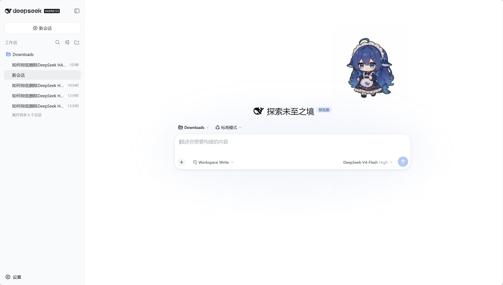

# dsh-pet 🐾

<p align="center">
  <a href="https://www.npmjs.com/package/dsh-pet"></a>
  <a href="https://www.npmjs.com/package/dsh-pet"></a>
  <a href="https://www.npmjs.com/package/dsh-pet"></a>
  <a href="https://github.com/PC2005-cloud/dsh-pet"></a>
  <a href="https://github.com/PC2005-cloud/dsh-pet/blob/main/LICENSE"></a>
  
  
</p>

一只住在 [DeepSeek Harness](https://github.com/deepseek-ai/deepseek-harness) 里的桌面宠物：待机呼吸、随机动作（打瞌睡、玩魔方、吃火锅……）、左右转向、屏幕漫游、点击 Q 弹、拖拽甩抛反弹、右键菜单点播——一百余段透明动画随时无缝衔接；还能跟随 DSH 会话事件切换工作状态动画、按档位播放余额动画 + 头顶气泡、碎碎念与对话聊天、待办挂在头顶按时提醒、困了自己睡下。可多开同屏，能脱离浏览器住上**桌面**（透明置顶小窗），也能完全不装 DSH 独立跑；更能自己添加**全新宠物种类**（pet pack）。

<p>
  
  
</p>

完整文档、全部动画预览与制作链在仓库：**<https://github.com/PC2005-cloud/dsh-pet>**

---

## 安装

两条命令行装法，按你在用的界面选 `--profile`：`dsh web` 填 `web`，桌面应用（Electron 版）填 `desktop`。

```sh
dsh plugin --profile web add dsh-pet        # dsh web
dsh plugin --profile desktop add dsh-pet    # 桌面应用
```

桌面应用也可以不开终端：打开「插件管理」页，安装框里填 `dsh-pet` 即可。

装完**重开 DSH**（`dsh web` 用户则重启 `dsh web`）才生效——运行中的进程持有内存里的旧插件。宠物默认落在界面右上角。

前置要求、源码安装（clone 后 `npm run build` 再 `add file:`）、首次安装时 Electron 的自动下载、装完会看到什么，见 [INSTALL.md](https://github.com/PC2005-cloud/dsh-pet/blob/main/INSTALL.md)。

### 独立模式（不装 DSH 也能用）

- **绿色版**：Release 附件里的 `dsh-pet-win-x64.zip`（Windows x64），解压双击 `dsh-pet.exe`，不需要 Node 也不需要 DSH。
- **npm**：`npm install -g dsh-pet` 后跑 `dsh-pet-standalone`（`--check` 只体检，`--port` 换端口），跨平台。

独立模式能动画、拖拽甩抛、右键菜单、多开、自定义素材与 pet pack；余额、碎碎念、对话、系统通知需要 DSH 的凭据与模型连接，故不可用。

## 功能

只做桌宠本身，不碰 DSH 内核；能力就下面这些。

- **100+ 段动画资产**：待机、走动漫游、玩耍、工作、对话等全部表现都由透明 webm（VP9-alpha）驱动，按权重首尾相接，也可换成自己的素材。
- **多开与种类**：同时养多只，各自大小与位置；自定义宠物种类（pet pack），一类一套动画、头像与素材。
- **三种运行形态**：DSH web 的浏览器 overlay、DSH 桌面应用的透明置顶窗、完全不依赖 DSH 的独立模式。
- **交互与物理**：点击回应、拖拽甩抛、双击弹弓、宠物互撞；同一套物理与 Q 弹挤压手感，参数可调。
- **手机与触屏**：触屏直接拖拽甩抛；手机上还能倾斜手机改重力方向、摇一摇把宠物甩出去、碰撞时震动反馈——三项在设置页「移动端效果」里可分别关闭（传感器需 HTTPS 或 localhost）。
- **碎碎念与对话**：按周期自动说一句，也能随时聊；记忆持久化、可配图（选文件 / 拖入 / 粘贴 / 截屏）、对话可联动当场演一段动作。
- **语音（说与听）**：回复与手动碎碎念会念出来，音色、音量与总开关可配；按住话筒说一句，录音转成文字直接填进输入框。
- **余额展示**：内置常见服务商的余额 / 额度查询，按剩余额度分档播动画并弹气泡（含本期用量页）；也可以登记自己的服务商。
- **工作状态联动**：跟随 DSH 会话状态切六档动画（思考 / 工作 / 整理 / 等待 / 成功 / 出错），气泡跟着当前工具与命令说话，并常驻头顶一句。
- **待办事项**：一句话加可选到期时间，清单挂在宠物头顶；越临近到期提醒越密，由宠物说出来，宿主定时器驱动，关掉页面也按时提醒。
- **睡觉**：右键「睡觉」或鼠标停上去按 `S` 睡下，点一下或右键「起来」叫醒；睡着时完全安静——随机动作、碎碎念、余额、待办与工作状态都不打扰，还会按周期说梦话；睡姿可用 `animations.sleep` 配多套。
- **系统通知**：任务完成或需要确认时弹系统通知（带会话名与回复开头），点一下回到对应会话。
- **右键菜单与快捷键**：换动画、开聊、配图说话、回到原位、显示位置、打开 DSH / 网站、重载配置；新增「打开对话 / 对话弹窗 / 语音输入 / 截图到对话」可配快捷键，`1`–`4` 直接切显示位置。
- **八种语言**：跟随 DSH 当前语言（简中 / 英 / 日 / 德 / 西 / 法 / 葡 / 俄）。
- **其他**：点击音效、系统托盘与每只宠物的显示位置。

各能力的详细说明见 [FEATURES.md](https://github.com/PC2005-cloud/dsh-pet/blob/main/FEATURES.md)；配置（大小 / 位置 / 多开 / 物理 / 模型 / 人设 / 宠物种类）见 [CONFIG.md](https://github.com/PC2005-cloud/dsh-pet/blob/main/CONFIG.md)。

## 🔌 对外接口（供其他插件调用）

桌宠不只自己玩，也对外开放两条调用通道，让别的插件或脚本能驱动它、读它的状态：让它说一句指定的话、播一段指定动画、与它对话；读它当前说的话、工作状态、系统通知与余额。

- **通道一 · HTTP**：挂在 DSH 自己的 Web 服务上（前缀 `/dsh-pet-7340`，只监听本机、无鉴权），跨进程、脚本可直接调。动作类接口只回 `{ok}`，数据统一从 `GET /state` 读。
- **通道二 · Cordis 服务**：客户端半侧在 DSH web 页面内注册，同页客户端插件用 `ctx.get('petApi7340')` 直接取，零网络、零端口；只在该页面实例内有效。

明细：[API.md](https://github.com/PC2005-cloud/dsh-pet/blob/main/API.md)（HTTP 一览）、[openapi.yaml](https://github.com/PC2005-cloud/dsh-pet/blob/main/openapi.yaml)（OpenAPI 3.1 契约）、[CORDIS-API.md](https://github.com/PC2005-cloud/dsh-pet/blob/main/CORDIS-API.md)、[CORDIS.md](https://github.com/PC2005-cloud/dsh-pet/blob/main/CORDIS.md)。语音合成、语音识别、余额查询各留一个注册口，注册自己的实现后就不再用内置的。

## 兼容性

- **操作系统**：Windows / Linux / macOS 三端均可运行——浏览器 overlay 与桌面模式（Electron 透明置顶窗）行为一致；Electron 按平台自动探测/下载，无需手动安装。
- **无头 / 无桌面环境**：Linux 无 `DISPLAY` / `WAYLAND_DISPLAY` 时自动判定无显示、跳过桌面窗口，浏览器 overlay 不受影响。
- **浏览器**：兼容 **Chromium 内核（Chrome / Edge 等）与 Firefox**——透明动画依赖 VP9-Alpha webm，均已实测透明确认；**不支持 Safari**（macOS 不认 webm alpha），macOS 请用 Release `assets-mov` 里的 HEVC-alpha `.mov` 素材。
- **多显示器**：跨屏漫游/抛掷以各屏工作区为界，异构缩放（各屏 DPI 不同）、任务栏条带、屏幕之间空洞均正确判定；「锁定在当前屏幕」可让它只在一块屏内活动。
- **DSH 版本**：当前在 dsh `0.2.2-alpha.2` 下开发并测试；`engines.node >= 22.12`。
- **依赖**：运行时依赖（React / Cordis / DSH 各包）由宿主提供，本包不打包它们。

## 从零生成你自己的宠物

本项目是**完整的三件套**，任何人 clone 仓库都可以从零做出自己的桌面宠物：**① 提示词配方**（AI 生成绿幕动画）→ **② 素材生成链**（源视频 → 透明 webm / Safari 用 mov 管线）→ **③ 插件**（运行在 DSH 里的宠物本体）。换角色、换动作、换风格，全流程可复现，步骤见 [MAKE-YOUR-OWN-PET.md](https://github.com/PC2005-cloud/dsh-pet/blob/main/MAKE-YOUR-OWN-PET.md)。

## 包内容

- `lib/` 构建产物（宿主半侧 `index.js`、浏览器半侧 `client.js`、独立模式 CLI `standalone.js`、类型声明）
- `src/` 源码（`host/` 宿主半侧、`client/` 浏览器半侧、`shared/` 双端共用纯逻辑、`standalone/` 独立模式）
- `assets/webm/` 动画播放资源、`assets/config.jsonc` 默认配置、字体 / 音效 / 图标
- `runtime/electron-helper` 桌面模式运行壳、`cordis.patch.yml` bundle 层补丁
- 素材链的 `prompts/`、`video/`、`scripts/` 在仓库里，不随 npm 包发布

## 💬 反馈与发版节奏

欢迎提 [issue](https://github.com/PC2005-cloud/dsh-pet/issues) 与 PR——bug、体验问题随时反馈。**新功能请先开 issue** 说明使用场景，确认后再动手。这个插件专注桌宠与 DSH 本身，偏离太远的需求一般不会做。动手前也请先翻一眼 [提交记录](https://github.com/PC2005-cloud/dsh-pet/commits/main)，确认不是已经修掉的同款问题。

- **小修不单独发版**：不影响使用的小 bug 与优化会累计到下一个版本一起发，所以「`main` 上已经修了」不等于「你装的这版已经包含」。
- **想立刻用上未发布的修复**：按 [INSTALL.md](https://github.com/PC2005-cloud/dsh-pet/blob/main/INSTALL.md) 的「从源码安装」把插件指向本地仓库；宿主半侧的改动要重开 DSH 才生效（浏览器半侧刷新页面即可）。
- **报 bug 时请带上**：插件版本、`dsh` 版本、操作系统、复现步骤（有日志或截图更好）。

## 许可

- 代码：MIT
- 素材（动画/提示词/源视频）：允许开源使用，**禁止商用**
- **二次创作（二创）约定**：基于本项目的衍生 / 改版 / 换皮作品，在 **GitHub 仓库、产品官网等公开渠道**上须附上原作者 GitHub 地址：<https://github.com/PC2005-cloud/dsh-pet>
- **形象出处**：宠物形象为社区二创的 DeepSeek「大肥鱼」（鲸鱼娘），**非 DeepSeek 官方形象**；原型「溟月」出自 B 站 [@上善无形](https://space.bilibili.com/4456176)，DeepSeek 版（女仆鲸鱼娘）设计出自 B 站 [@ZipZipPipe](https://space.bilibili.com/4168597)
- **形象授权**：[CC BY-NC-SA 4.0](https://creativecommons.org/licenses/by-nc-sa/4.0/deed.zh-hans)（署名 · 非商业 · 相同方式共享），[声明原文](https://www.bilibili.com/opus/1247156596114456581)：「大肥鱼是遵守CC BY-NC-SA 4.0协议的形象，不可以以任何形式商业化。若您非常喜爱该形象，希望其拥有实体，您可以自行定制。」
