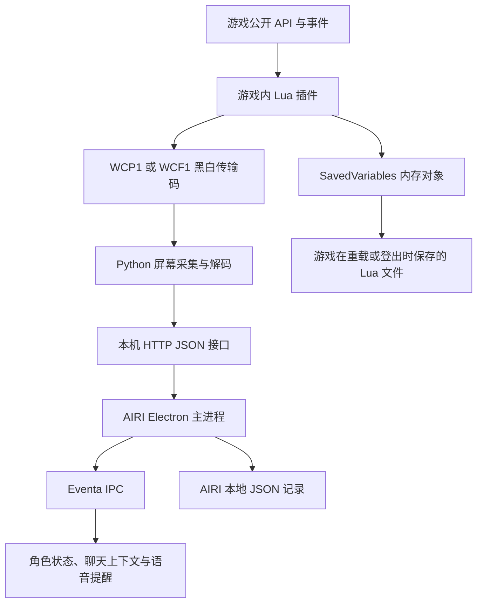

# 游戏插件与 AIRI 通信说明

更新日期：2026-11-01。本文介绍本仓库中的实际通信链路、源码入口和排查方法。

## 1. 通信链路

实时链路分为四层。游戏内插件采集公开数据并显示传输码。Python 桥接读取屏幕像素，校验并解码。AIRI 主进程读取本机 HTTP 接口，保存已经接收到的数据。聊天界面通过 Eventa IPC 获取状态，再决定是否增加聊天上下文或发出语音提醒。



这套实现中，游戏 Lua 插件不向 AIRI 发 HTTP 请求，也不自行持续改写硬盘中的固定 JSON 文件。屏幕传输码是主要的实时数据入口。SavedVariables 是另外一条存档路径。

Python 桥接不调用大模型。模型服务和语音服务由 AIRI 配置。传输码解码不需要 CurseForge API key，也不依赖无限图鉴 MCP。

## 2. 组件与版本

| 组件 | 本次同步版本 | 作用 | 源码 |
| --- | --- | --- | --- |
| 正式服插件 | 2.19.0 | 采集正式服数据，显示 WCP1 网格 | [WoWMapCompanion](WoWMapCompanion/) |
| 无限服插件 | 1.17.0 | 独立采集无限服数据，显示 WCF1 网格 | [WoWForeverCompanion](WoWForeverCompanion/) |
| 宏导入插件 | 1.0.0 | 校验、保存宏，提供操作回执 | [WoWMacroImport](WoWMacroImport/) |
| 本机桥接 | 2.19.0 | 采集屏幕、解码、维护状态、提供 HTTP | [WoWCompanionBridge](WoWCompanionBridge/) |
| AIRI 桌面端 | 以仓库源码为准 | 管理桥接、轮询、存储、聊天和语音 | [桌面服务](../airi/apps/stage-tamagotchi/src/main/services/airi/) |

正式服与无限服分别使用 `retail`、`forever` 配置，不混用角色、金币或事件。怀旧服插件推荐和安装功能不代表本仓库已经提供怀旧服实时遥测。

`WoWIntelAPI` 是早期的游戏外攻略查询服务，不是 Lua 插件，也不属于这条通信链路的必需组件。

## 3. Lua 插件如何产生数据

插件通过 `PLAYER_ENTERING_WORLD`、`PLAYER_LEVEL_UP`、`PLAYER_MONEY`、战斗、区域、背包、装备、任务和天赋事件更新观测。具体读取逻辑位于各功能 Lua 文件。

- `WoWMapCompanion.lua` / `WoWForeverCompanion.lua`：初始化、事件处理、角色心跳与导出。
- `Protocol.lua`：字段清理、JSON 编码、帧头与 CRC。
- `Telemetry.lua`：把字节绘制成黑白格子。
- `Transfer.lua`：安排状态帧与独立数据帧的轮播。
- `Equipment.lua`、`Inventory.lua`、`Quests.lua`、`Talents.lua`：对应功能数据。
- `Calendar.lua`、`GroupBuffs.lua`：日历批次与组队增益观测。
- `OfflineHistory.lua`：SavedVariables 中的角色、装备、金币流水和升级记录。

角色心跳每秒采样一次。`tick` 标识心跳变化，`seq` 标识业务状态变化。会话重建后 `session` 改变。
传输轮播每 250 毫秒前进一步，安排状态帧和其他数据帧。完整装备等大数据需要多帧传输，不能把一次 HTTP 返回理解为所有资料都已更新。

不可读取或受限制的数据保持未知。缺失属性、坐标或装备槽位不能被解释成零值、没有装备或旧角色的数据。

## 4. 屏幕传输码格式

默认网格为 64 列 × 64 行，每格一个物理像素，共 4096 位，即 512 字节。黑色代表 0，白色代表 1。按行排列，每字节从最高位开始。

| 字节偏移 | 长度 | 内容 |
| --- | --- | --- |
| 0 | 4 | 正式服 `WCP1`，无限服 `WCF1` |
| 4 | 2 | JSON 正文的 UTF-8 字节长度，小端整数 |
| 6 | 2 | 正文的 CRC16-CCITT，小端整数 |
| 8 | 最多 504 | UTF-8 JSON 正文，剩余空间补零 |

CRC 初值为 `0xffff`，多项式为 `0x1021`。Python 对应 `binascii.crc_hqx(payload, 0xffff)`。
CRC 用于发现传输损坏，不提供加密或身份认证。可见网格中包含角色信息，不适合在公开截图中展示真实数据。

主状态快照使用 `v=3`，包含身份、等级、职业、专精、地图、战斗、在线状态及金币计数。
`account` 是插件生成并保存在本地的账号分组标识，不是战网账号或登录凭据。
坐标 `px`、`py` 是地图比例乘以 10000 的整数。例如 `1234,5678` 对应地图坐标 `12.34,56.78`，不能用于计算可行走路线。

以下是独立数据类型。它们与主心跳共用网格，互相轮播。

| `kind` | 数据 |
| --- | --- |
| `eq` | 新获得的装备 |
| `cmp` | 装备比较 |
| `gear` | 当前全身装备快照 |
| `inv` | 背包库存 |
| `qlog` | 任务日志 |
| `traits` | 已提交的天赋配置 |
| `offer` / `swap` | 游戏内换装提议与结果 |
| `calendar` | 日历批次 |
| `buff` | 队伍增益检查 |
| `macro` | 宏导入窗口状态与保存回执 |

装备、库存、任务、天赋等较大内容使用分片。每片最多携带 240 个原始 JSON 字节，经 Base64 后放入 `d` 字段。
分片头中的 `s`、`g`、`id`、`p`、`n` 分别表示会话、角色 GUID、修订、片号和总片数。
接收端完整重组并校验后才发布一份数据，不会拼接两个角色或两个修订的片段。
分片不刷新主角色心跳。只收到装备片段，不能证明角色仍在线。

详细字段、大小上限与分片规则见 [WCP1 / WCF1 协议](WoWCompanion-PROTOCOL.md)。

## 5. Python 桥接如何解码

`capture.py` 使用 Windows 屏幕采集读取渲染像素，不读取游戏进程内存。
`geometry.py` 在配置区域及有界邻域内恢复采样几何。
`protocol.py` 检查黑白像素、协议标识、长度、CRC、UTF-8、JSON 和字段。
`state.py` 维护当前角色、分片、事件及独立错误。`server.py` 提供本机接口。

默认采集间隔为 100 毫秒。它和游戏心跳、传输轮播是不同计时器。
默认超过 5 秒没有新鲜角色心跳后，状态变为 `stale`。重复帧和重复分片不会延长角色有效期。
画面被遮挡、最小化、缩放失真或截取位置错误时，数据会暂时不可用。桥接不会把校验失败的像素修补成成功状态。

| 配置 | 正式服 | 无限服 |
| --- | --- | --- |
| HTTP 地址 | `http://127.0.0.1:18765` | `http://127.0.0.1:18766` |
| 协议 | `WCP1` | `WCF1` |
| 采集配置文件名 | `bridge-config.json` | `bridge-config-forever.json` |

主要接口：

| 方法 | 路径 | 用途 |
| --- | --- | --- |
| GET | `/health` | 服务版本、游戏和协议 |
| GET | `/api/status` | 当前状态、快照、事件、分片结果及错误 |
| GET | `/api/events?after=N` | 游标之后的事件 |
| GET | `/api/frame.bmp` | 当前采集预览 |
| POST | `/api/config` | 位置、格宽、间隔、暂停状态 |
| POST | `/api/demo` | 明确切换演示模式 |

服务只监听回环地址，并检查 Host 和浏览器 Origin。不要把遥测接口作为公网服务转发。
`18767` 的可选正式服只读资料查询是独立模式，不是角色遥测入口，也不是游戏插件主动上传的数据。

## 6. AIRI 如何接收和使用

1. 用户启用对应游戏的陪伴连接。
2. `CompanionBridgeRuntime` 检查桥接健康状态，必要时启动受管 Python 子进程。
3. `CompanionProfile` 调用 `CompanionBridgeClient` 读取 `/api/status`。每轮完成后约 250 毫秒启动下一轮。
4. 主进程按 `bridgeSchema` 校验响应，并检查游戏与协议是否匹配。
5. 主进程更新金币、装备、比较和升级记录，处理旧请求失效与退出清理。
6. 渲染进程通过 `wowCompanionGet` 等 Eventa 调用读取状态，按新鲜度和用户偏好加入聊天上下文或提醒。

HTTP 请求有 2 秒超时，不接受重定向。关闭连接、切换配置后，旧响应不能恢复先前角色的状态。
演示数据带有独立来源标记，不能记入真实金币和装备记录。
设备收到数据不等于一定播报，战斗安静、静音、去重、冷却时间和当前对话会继续约束提醒。

关键入口：

| 文件 | 作用 |
| --- | --- |
| [wow-companion-runtime.ts](../airi/apps/stage-tamagotchi/src/main/services/airi/wow-companion-runtime.ts) | 桥接查找、启动、健康检查与退出 |
| [wow-companion-client.ts](../airi/apps/stage-tamagotchi/src/main/services/airi/wow-companion-client.ts) | 本机 HTTP 与响应校验 |
| [wow-companion.ts（主进程）](../airi/apps/stage-tamagotchi/src/main/services/airi/wow-companion.ts) | 两服配置、轮询与持久化 |
| [wow-companion.ts（契约）](../airi/apps/stage-tamagotchi/src/shared/wow-companion.ts) | 游戏、主状态与桥接响应结构 |
| [Eventa 契约](../airi/apps/stage-tamagotchi/src/shared/eventa/wow-companion.ts) | 主进程与界面通信 |
| [wow-companion.ts（界面）](../airi/apps/stage-tamagotchi/src/renderer/stores/wow-companion.ts) | 聊天上下文、事件和提醒 |

## 7. SavedVariables、snapshotJSON 与硬盘文件

Lua 导出时更新 `db.snapshot` 和 `db.snapshotJSON`。离线历史模块把装备、金币变化和升级观测加入 `snapshotJSON` 的 `offlineHistory`。
这些更新先发生在游戏内存。正常 `/reload`、登出或退出时，游戏把 SavedVariables 写入硬盘。强制终止游戏前尚未保存的数据仍可能丢失。

| 客户端 | SavedVariables 全局变量 | 常见文件位置 |
| --- | --- | --- |
| 正式服 | `WoWMapCompanionDB` | `<正式服目录>/WTF/Account/<账号目录>/SavedVariables/WoWMapCompanion.lua` |
| 无限服 | `WoWForeverCompanionDB` | `<无限服目录>/WTF/Account/<账号目录>/SavedVariables/WoWForeverCompanion.lua` |

`snapshotJSON` 是上述 Lua 文件中的字符串字段，不是插件自行创建的独立 `.json` 文件。
金币历史是公开钱包变化的观测，不自动知道每笔变化购买了什么。升级耗时保留完整、部分或未知标记。

**本仓库当前的边界：**这里的通用 Python 遥测服务只从屏幕网格接收角色数据。当前提交的 AIRI `CompanionProfile` 没有扫描 SavedVariables 或导入 `snapshotJSON` 的入口。
因此，本次发布的插件具有离线保存能力，但不能据此认定这份 AIRI 已经实现离线历史自动补录。
后续接入文件导入器时，需要单独选择文件、解析 Lua 字符串、校验 JSON、按游戏与角色去重，并保留观测时间。不能直接执行用户存档中的 Lua。

AIRI 已接收到的数据则由主进程保存到应用用户数据目录。它与游戏 SavedVariables 分离。
例如正式服的 `wow-companion-gold-v1.json`、`wow-companion-loadouts-v1.json`、`wow-companion-level-history-v1.json`。无限服使用含 `forever` 的对应文件名。

## 8. AIRI 向游戏回传：宏导入示例

实时观测链路主要从游戏流向 AIRI。宏导入另外使用 Windows 剪贴板和固定模拟输入，不是通过 HTTP 直接执行游戏 Lua。

1. AIRI 生成宏正文，主进程校验请求与对应游戏窗口。
2. 辅助进程把正文放入剪贴板，并根据新鲜传输码等待非战斗状态。
3. 模拟输入 `/import-marco` 和请求编号，等待导入窗口就绪。
4. 模拟 `Ctrl+V` 和 `Ctrl+Enter`，提交给 `WoWMacroImport`。
5. 游戏插件校验并保存角色宏，通过 `kind=macro` 帧返回状态与结果。
6. 桥接收到匹配回执后，辅助进程才报告保存成功。

宏导入只保存宏，不执行宏正文。窗口丢焦点、进入战斗、回执不匹配或采集失效会使流程失败。
游戏内换装也保留自己的确认点击，不通过传输码自动执行角色动作。
详见 [宏导入插件说明](WoWMacroImport/README.md) 与 [桌面宏导入实现](../airi/docs/ai/adr/wow-macro-import.md)。

## 9. 使用与排查

安装时，把对应插件文件夹放入该客户端的 `Interface/AddOns`，保留目录名。更新后重载游戏界面，并完全退出、重新启动陪伴精灵。
使用正式服 `/wowc compact`、无限服 `/wowf compact` 恢复紧凑网格。保持网格完整可见，再校准采集位置与格宽。

在 PowerShell 中检查本机连接：

```powershell
Invoke-RestMethod http://127.0.0.1:18765/health
$status = Invoke-RestMethod http://127.0.0.1:18765/api/status
$status | Select-Object game, protocol, status, source, ageSeconds, error
```

无限服使用端口 `18766`。仅在本机查看完整状态，公开反馈时隐藏角色名、GUID、账号标识及文件路径。

| 现象 | 排查方向 |
| --- | --- |
| 连接失败 | Python 版本、陪伴连接是否启用、端口占用、桥接启动错误 |
| `waiting` | 对应插件是否启用、网格是否可见、是否采集到正确客户端 |
| `stale` | 角色心跳停止、游戏最小化、网格遮挡或画面不再更新 |
| CRC 或像素错误 | 游戏分辨率、UI 缩放、HDR、采集坐标、格宽、覆盖层 |
| 主状态正常，装备资料未到 | 检查独立错误与分片进度，等待完整修订，不复用其他角色资料 |
| 服务可用但没有语音 | 检查静音、战斗安静、提醒偏好、去重、冷却和语音服务 |
| 离线期间的数据没有出现 | 检查游戏是否保存；同时核对当前 AIRI 是否包含文件导入功能 |
| 宏未导入 | 检查导入插件、战斗与窗口焦点、传输码新鲜度、对应保存回执 |

## 10. 开发验证

生产桥接使用 Python 3.10+ 标准库，真实屏幕采集需要 Windows。
插件单元测试另外需要测试用 Lua 5.1 运行时 Lupa，它不属于游戏插件或生产桥接依赖。
依赖已就绪时，在仓库根目录运行：

```powershell
python -m unittest discover -s WOWAddons/WoWMapCompanion/tests -q
python -m unittest discover -s WOWAddons/WoWForeverCompanion/tests -q
python -m unittest discover -s WOWAddons/WoWCompanionBridge -q
```

跨语言测试使用实际 Lua 编码结果检查 Python 解码与重组。自动化通过不等于已经验收真实游戏画面、输入法、焦点和语音设备。

当前可安装源码以各插件目录为准。仓库中的旧版 ZIP 是历史交付包，不随本次源码同步自动升级。
